<div align="center">

# ◉ Market Pulse

### Read the market. Find the signal. Follow the flow.

An open NSE market dashboard that brings breadth, technical setups, options context,
relative strength, liquidity, and market news into one research workspace.

<br />

`NIFTY 200` &nbsp;·&nbsp; `10 dashboard views` &nbsp;·&nbsp; `5 signal timeframes` &nbsp;·&nbsp; `No account or database`

</div>

---

## The idea

Market Pulse is built around a practical question: **what is happening across the market, and where should I look next?** The Pulse view starts with session context. The rest of the dashboard lets a trader move from that context into a signal, stock, option chain, or liquidity level without leaving the workspace.

> **A research tool, not a trading system.** Market Pulse does not place orders or provide investment advice. Its price, flow, and positioning views are estimates based on public data.

## Explore the workspace

| View | What it helps you inspect |
| :--- | :--- |
| **Pulse** | Breadth, market mood, estimated sector money rotation, index context, India VIX, and a turnover weighted market map |
| **Signals** | RSI divergence and MACD crossovers for 5m, 15m, 30m, 60m, and daily scans |
| **Options** | Option chain, put/call ratio, open interest, implied volatility, max pain, and writers’ levels |
| **OI Flow** | Strike by strike open interest changes and the in-session PCR trail for major indices |
| **Liquidity** | Volume or time-at-price profile, value area, swing levels, and available option OI walls |
| **Radar** | Relative Rotation Graph (RRG) sector positions and symbol level metrics |
| **Strength** | Relative strength rankings and sector performance against NIFTY |
| **Screeners** | Rule based groups for breakouts, moving averages, RSI, volume, gaps, and money flow |
| **Watchlist** | Browser saved symbols with quote, signal, and stock news context |
| **Market Wire** | Public market headlines with source filters |

The web app also includes a per-stock chart drawer, Nifty 200 symbol search (`⌘K` / `Ctrl+K`), an IST market clock, and a light/dark theme switch.

## Dashboard screenshots

Explore the dashboard view by view. These desktop screenshots show a live data snapshot; quotes, signals, and headlines change as their providers update.

<table>
  <tr>
    <td width="50%"><strong>Pulse</strong> · market context and money flow<br /><a href="docs/screenshots/pulse.png">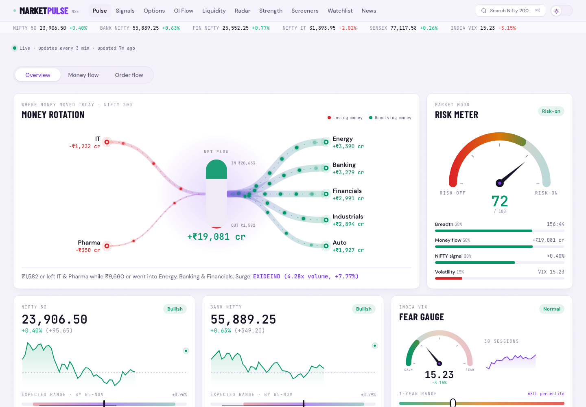</a></td>
    <td width="50%"><strong>Signals</strong> · technical setup scanner<br /><a href="docs/screenshots/signals.png">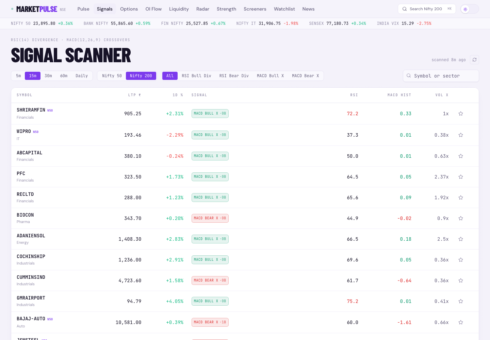</a></td>
  </tr>
  <tr>
    <td width="50%"><strong>Options</strong> · option chain context and volatility<br /><a href="docs/screenshots/options.png">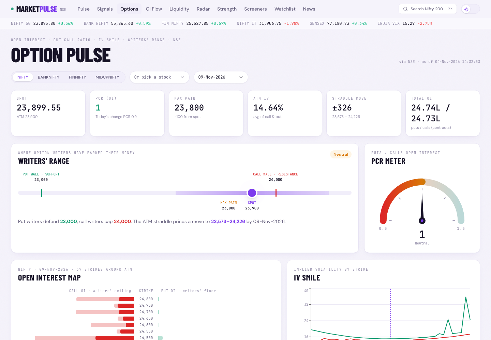</a></td>
    <td width="50%"><strong>OI Flow</strong> · changes in open interest<br /><a href="docs/screenshots/oi-flow.png">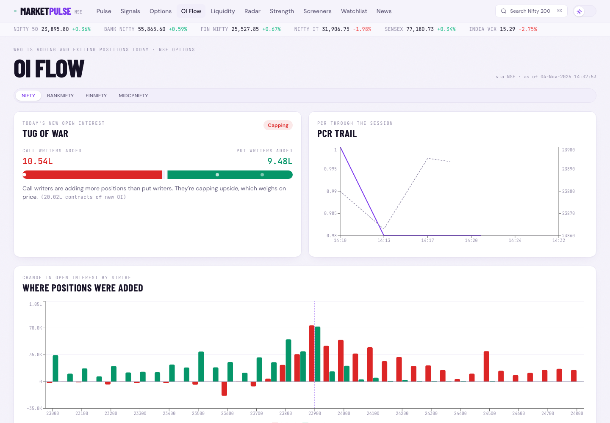</a></td>
  </tr>
  <tr>
    <td width="50%"><strong>Liquidity</strong> · volume profile and key levels<br /><a href="docs/screenshots/liquidity.png">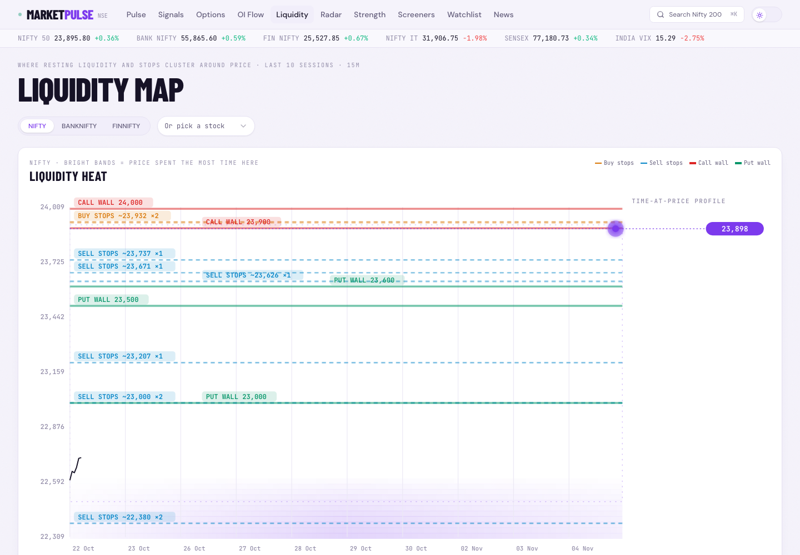</a></td>
    <td width="50%"><strong>Radar</strong> · sector rotation and relative momentum<br /><a href="docs/screenshots/radar.png">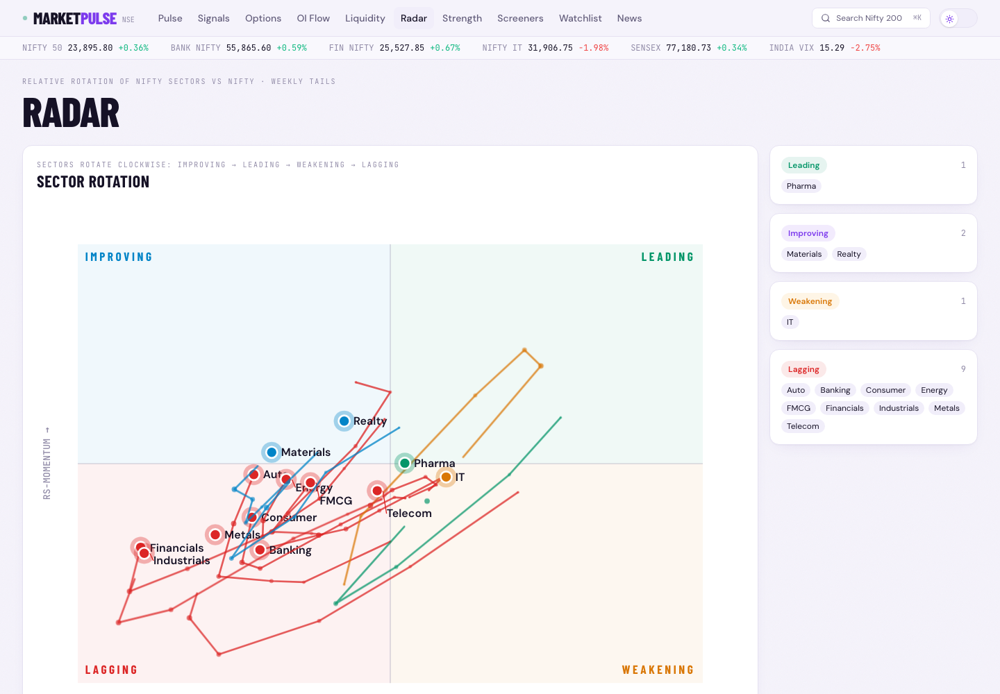</a></td>
  </tr>
  <tr>
    <td width="50%"><strong>Strength</strong> · relative performance rankings<br /><a href="docs/screenshots/strength.png">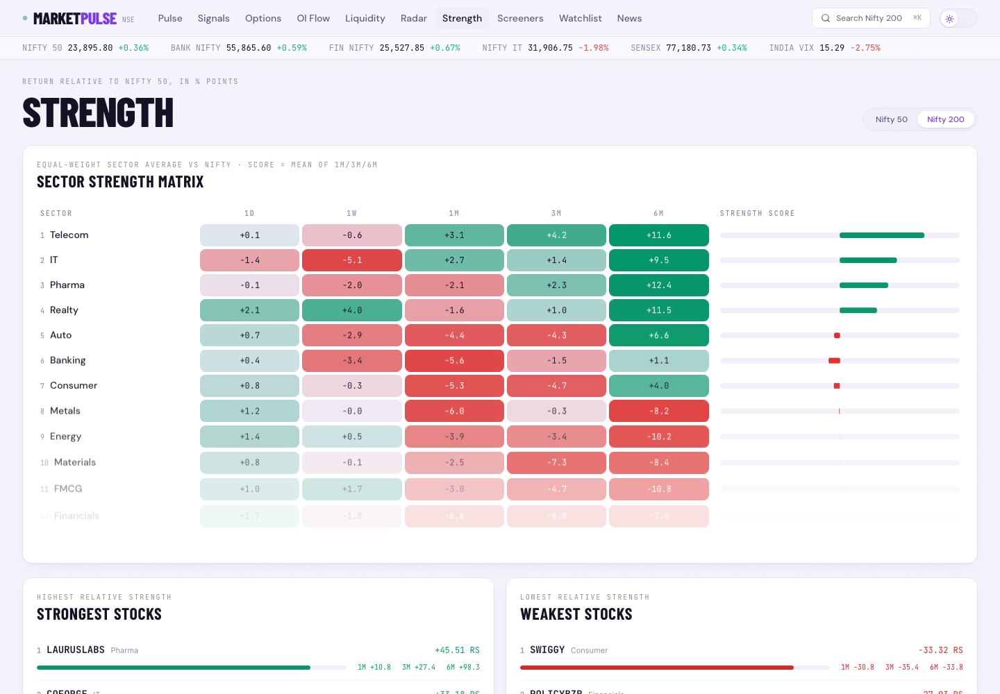</a></td>
    <td width="50%"><strong>Screeners</strong> · rule-based stock groups<br /><a href="docs/screenshots/screeners.png">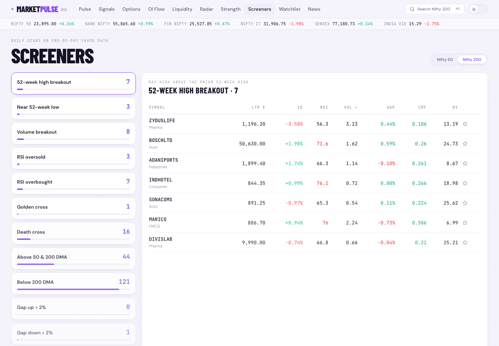</a></td>
  </tr>
  <tr>
    <td width="50%"><strong>Watchlist</strong> · saved symbols and their signals<br /><a href="docs/screenshots/watchlist.png">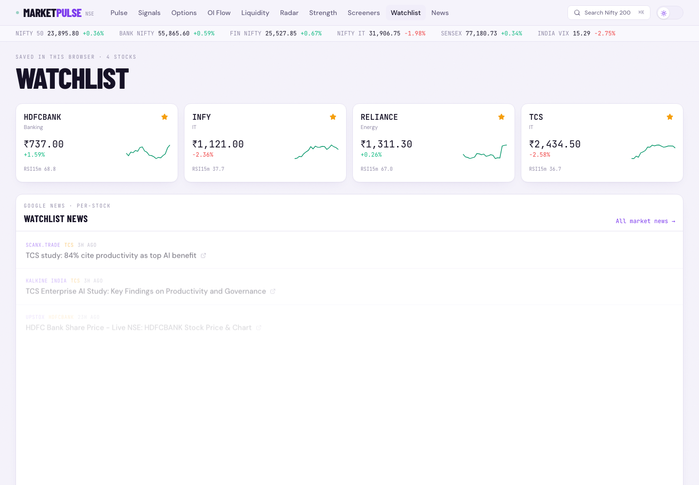</a></td>
    <td width="50%"><strong>Market Wire</strong> · filtered market headlines<br /><a href="docs/screenshots/news.png">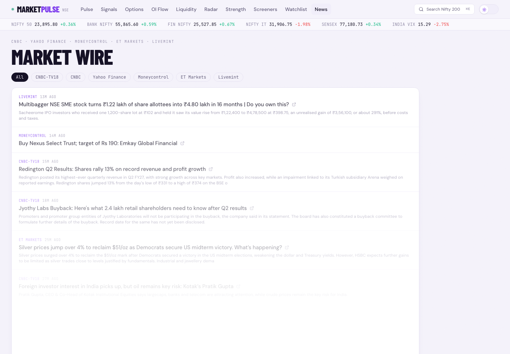</a></td>
  </tr>
</table>

## How the pieces connect

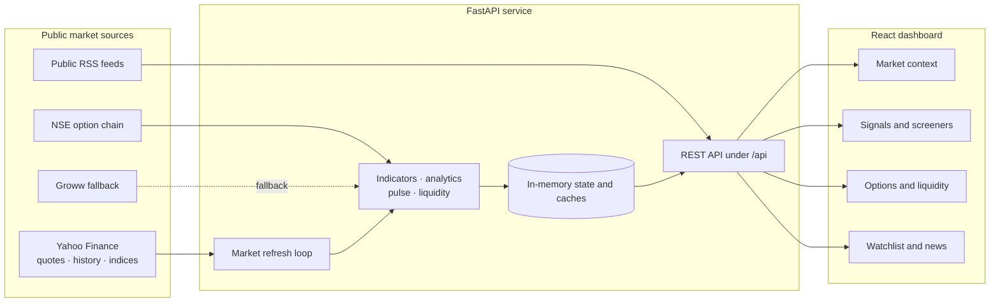

Quotes, scans, analytics, and option cache are held in process memory and reset when the backend restarts. The browser keeps its own watchlist and theme in `localStorage`. There is no database or sign-in flow.

## Run locally on macOS

Run the API and web client in **two Terminal tabs**. You’ll need Python 3.10+, Node.js, and Yarn Classic 1.22.22. Install Yarn if needed with `npm install --global yarn@1.22.22`.

### 1 · Start the API

```bash
cd backend
python3 -m venv .venv
.venv/bin/python -m pip install -r requirements.txt
.venv/bin/python -m uvicorn server:app --reload --host 0.0.0.0 --port 8000
```

The API base is `http://localhost:8000/api`. Interactive endpoint docs are at `http://localhost:8000/docs`.

### 2 · Start the dashboard

In the second tab, from the repository root:

```bash
cd frontend
yarn install
```

Create `frontend/.env` with the backend address (this local file is ignored by Git):

```dotenv
REACT_APP_BACKEND_URL=http://localhost:8000
```

Then start the frontend:

```bash
yarn start
```

Restart `yarn start` after changing `.env`. The app usually opens at `http://localhost:3000`. For access from another device, use the Mac’s LAN IP in the frontend URL and set `CORS_ORIGINS` in `backend/.env` to the frontend origin.

### Optional · Expo shell

The `mobile/` directory is an Expo starter shell, not a mobile implementation of the dashboard yet. Its current entry screen displays a static app image and reads `EXPO_PUBLIC_BACKEND_URL`; it does not call the API.

```bash
cd mobile
yarn install
yarn start
```

## Data, estimates, and refresh

| Data | Source and handling |
| :--- | :--- |
| Quotes, index history, and intraday bars | Yahoo Finance through `yfinance`; availability and delay are controlled upstream |
| Options | NSE is primary; Groww is the fallback. A cached response may be returned as stale if both sources fail |
| News | Public RSS from CNBC-TV18, CNBC, Yahoo Finance, ET Markets, Livemint, and Google News queries for Moneycontrol coverage |
| Universe | Nifty 200 symbols with Nifty 50 filtering where supported |
| Refresh | Backend refresh loop sleeps about 3 minutes during market hours or 30 minutes outside market hours after each refresh cycle |
| Persistence | Market state, option cache, and OI history are process memory; all reset on backend restart |

**Money flow is an estimate.** For each stock, turnover is price × volume and the close-location value compares the close with that session’s high/low range. Their product is aggregated by sector. It is a directional price/volume proxy, not exchange-reported institutional flows.

Upstream services can rate limit, block, or change endpoints. When that happens, pages may show missing or stale values. Option chain access is available only for supported indices and F&O-enabled Nifty 200 stocks.

## API map

All endpoints are prefixed with `/api`.

| Endpoint | Purpose |
| :--- | :--- |
| `GET /status` · `GET /universe` | Market state, refresh times, supported symbols, and sector mapping |
| `GET /overview` · `GET /pulse` | Index snapshot and composed market context |
| `GET /stocks?universe=nifty200&symbols=...` | Quotes, optionally scoped by universe or symbol list |
| `GET /signals?tf=15m&universe=nifty200&only_signals=true` | Technical scans; valid `tf`: `5m`, `15m`, `30m`, `60m`, `1d` |
| `GET /stock/{symbol}?tf=15m` | Stock quote and chart indicator series |
| `GET /options/{symbol}?expiry=...` · `GET /options-symbols` | Option chain and supported option symbols |
| `GET /oi-flow/{symbol}` · `GET /liquidity/{symbol}` | Open-interest history and liquidity map |
| `GET /radar` · `GET /radar/{symbol}` | Sector RRG and per-symbol radar metrics |
| `GET /strength?universe=nifty50` · `GET /screeners?universe=nifty200` | Strength rankings and screener groups |
| `GET /news?source=...` · `GET /news/stocks?symbols=...` | Market headlines and selected-stock headlines |

See the [full project guide](docs/PROJECT_GUIDE.md) for code ownership, calculation notes, API behavior, and troubleshooting. The [presenter notes](docs/PRESENTATION_NOTES.md) provide a talk track, demo order, and answers to common questions.

## Project map

```text
backend/    FastAPI routes, provider adapters, refresh loop, and calculations
frontend/   React pages, shared components, charts, API client, local preferences
mobile/     Expo application shell (dashboard parity is not implemented)
docs/       Project guide and supporting documentation
memory/     Product requirements and implementation notes
```

## Stack

**Web:** React 19 · React Router · Tailwind CSS · Recharts · Axios · Radix UI

**API:** FastAPI · pandas · NumPy · yfinance · requests · feedparser

**Mobile shell:** Expo · React Native · Expo Router

---

<div align="center">

**Market Pulse** · public market data, translated into a clearer research workflow.

</div>
