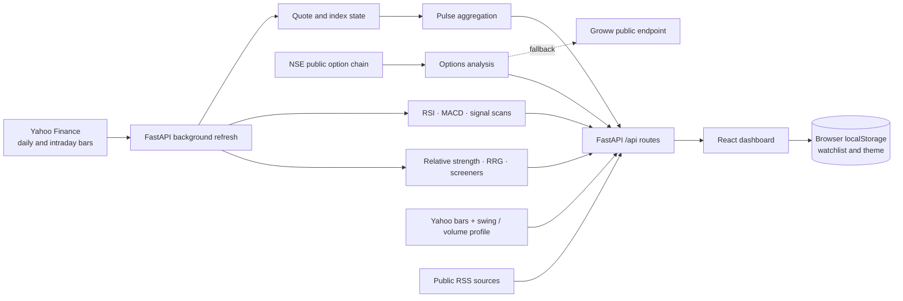

# Market Pulse · Project guide

> A technical and product handoff for the Market Pulse NSE dashboard.

This guide explains what the repository currently contains, how its parts work together, what the analytics mean, and how to run or extend the project. It documents implemented behavior rather than proposed features. The shorter [README](../README.md) is the entry point for the repository.

## 1. Product overview

Market Pulse is a free, accountless research dashboard for Indian equities and index derivatives. Its primary universe is the Nifty 200, with a Nifty 50 filter in supported views. A trader can move from the overall session read into technical signals, a stock chart, options positioning, liquidity levels, relative strength, screeners, a watchlist, and news.

### Core user path

1. **Orient:** read advances/declines, index direction, volatility, and the market mood score on Pulse.
2. **Locate participation:** compare sector estimates, turnover, leaders/laggards, and volume surges.
3. **Find candidates:** scan RSI divergence and MACD crossovers, or use the screeners and relative-strength pages.
4. **Inspect context:** open a stock chart, options chain, OI distribution, or liquidity profile.
5. **Keep track:** save symbols in a browser-local watchlist and review related news.

The tool provides observations, not order execution or investment recommendations. It has no accounts, broker integration, or persistent server-side user data.

## 2. System architecture



### Runtime responsibilities

| Layer | Main files | Responsibility |
| :--- | :--- | :--- |
| API and lifecycle | `backend/server.py` | Creates FastAPI, attaches `/api` routes and CORS, starts and cancels the market refresh task |
| Market ingestion | `backend/market.py` | Downloads Yahoo Finance bars, derives quote snapshots, runs scans, maintains in-memory state, aggregates news |
| Market universe | `backend/universe.py` | Nifty 200 and Nifty 50 symbol membership, sector assignments, index mapping, Yahoo ticker conversion |
| Technical analysis | `backend/indicators.py` | RSI, MACD, RSI price divergence, crossover detection, chart series |
| Pulse composition | `backend/pulse.py` | Mood score, estimated flows, index/VIX cards, market headline, treemap data |
| Cross-sectional analytics | `backend/analytics.py` | Stock metrics, relative strength, sector RRG, screener results |
| Options ingestion | `backend/nse.py` | NSE first / Groww fallback, option chain normalization, PCR, max pain, implied-volatility estimates, memory cache |
| Liquidity profile | `backend/liquidity.py` | Yahoo bars into volume/time-at-price profile, value area, swing levels, optional OI walls |
| Web client | `frontend/src/` | Dashboard routes, charts, page state, API requests, local browser preferences |
| Mobile shell | `mobile/` | Expo starter screen; it is not yet a mobile client for the dashboard API |

### Data lifecycle

The FastAPI lifespan starts `market.run_loop()` in the background. Each cycle refreshes daily quotes and index analytics, scans 15-minute signals first, snapshots supported index OI, then scans the other configured timeframes. After the cycle, the loop sleeps for about 180 seconds when the market is open or 1,800 seconds when closed. These are sleep intervals, so total cycle time also includes provider calls and calculations.

State lives in Python process memory. Quote snapshots, calculated signals, analytics, option response cache, and OI history are lost on restart. OI history is collected for NIFTY and BANKNIFTY during refresh cycles. The React client stores the watchlist and theme in browser `localStorage` (`mp_watchlist` and `mp_theme`); these survive an API restart but are local to that browser profile.

## 3. Data sources and freshness

| Data | Provider | Current behavior |
| :--- | :--- | :--- |
| Nifty 200 quotes | Yahoo Finance via `yfinance` | Daily bars are fetched in batches; quote rows use the latest bar present in the response |
| Index quotes | Yahoo Finance via `yfinance` | Includes the indices configured in `universe.py`, including NIFTY, BANKNIFTY, SENSEX, FINNIFTY, and India VIX where available |
| Index intraday lines | Yahoo Finance via `yfinance` | NIFTY and BANKNIFTY are requested at 5-minute intervals over a five-day period; the latest date is used for the line |
| Stock scans | Yahoo Finance via `yfinance` | Each scan timeframe maps to its own lookback: 5m/5d, 15m/10d, 30m/20d, 60m/1mo, 1d/1y |
| Options | NSE public option-chain endpoints | Primary source; NSE session requests have timeouts and short retries. A 401/403 starts a 15-minute cooldown |
| Options fallback | Groww public endpoints | Used when NSE is unavailable; option IV is derived by inverting Black–Scholes against the option’s reported LTP |
| News | Public RSS and Google News RSS query | Feeds include CNBC-TV18, CNBC, Yahoo Finance, ET Markets, Livemint, and a Google News query for Moneycontrol market coverage |
| Liquidity chart | Yahoo Finance bars | Uses recent 15-minute bars to estimate traded-volume distribution for stocks and time-at-price for indices |

Provider data is subject to delays, rate limits, access blocks, and upstream changes. Yahoo Finance does not supply the option-chain data used here. NSE and Groww are public web endpoints, not contracted service APIs; availability is not guaranteed.

### Freshness and failure behavior

- Quote and analytics timestamps are available from `GET /api/status` and the relevant response payloads.
- The options cache returns a fresh response within its market-dependent TTL. If a provider fails after the TTL, the last available response can be returned with `stale: true` and its age; without a usable cached response, the API returns HTTP 503.
- Invalid or unsupported stock symbols return 404. Invalid selected expiries return 400.
- Missing values can mean a provider did not return enough bars, an instrument is not supported by that provider, or an upstream request failed. Treat the response’s update time and stale marker as part of the data.
- RSS feed availability varies. News endpoints return the set of configured sources and whatever items could be retrieved/cached.

## 4. Calculations and interpretation

All analytics are deterministic calculations on upstream data. They are useful for organizing a review, but should not be read as predictions or a guarantee of future performance.

### Pulse

**Advances and declines** count quote rows with positive or negative daily percentage change. Unchanged rows are not counted in either side.

For each stock, the service estimates turnover in crore rupees as `close × volume / 10,000,000`. Close-location value (CLV) is:

```text
CLV = ((close − low) − (high − close)) / (high − low)
estimated stock flow = CLV × turnover
```

CLV ranges from roughly −1 (close near the low) to +1 (close near the high). These stock estimates are summed by sector. This is a price/volume directional proxy; it is **not** actual order flow, participant-level flow, or a measure of institutional buying.

The mood score is a weighted composite from 0–100:

| Component | Weight | Input |
| :--- | ---: | :--- |
| Breadth | 35% | Advances divided by advances plus declines |
| Money flow | 30% | Net estimated flow relative to estimated turnover, clamped to a bounded range |
| NIFTY signal | 20% | NIFTY percentage move and whether it is above its 20-session EMA |
| Volatility | 15% | Inverse of India VIX’s percentile within the fetched history |

The NIFTY expected range uses the India VIX-derived daily sigma when VIX is present; other index cards use the index’s recent 20-session volatility estimate. The VIX panel’s expected daily move is also a volatility estimate, not a forecast or confidence interval.

### RSI and MACD signals

- **RSI(14):** smoothed up/down close changes using an exponential weighting factor of `1/14`.
- **MACD(12, 26, 9):** difference between 12- and 26-period exponential moving averages, with a 9-period signal line.
- **Bullish RSI divergence:** price forms a lower pivot low while RSI forms a higher low; the earlier RSI pivot must be below 45.
- **Bearish RSI divergence:** price forms a higher pivot high while RSI forms a lower high; the earlier RSI pivot must be above 55.
- **MACD crossover:** histogram sign change, surfaced when detected in the latest three bars.
- Divergence detection uses recent pivot points inside a 60-bar lookback and requires the newest pivot to be recent. Signal visibility therefore depends on bar interval, data history, and the configured pivot rules.

These are rule-based conditions. They do not include every technical-analysis interpretation, are not independently validated trading strategies, and should not be treated as buy/sell instructions.

### Relative strength, radar, and screeners

Relative returns compare a stock’s return against NIFTY over 1D, 1W, 1M, 3M, and 6M windows. Strength ranks use the mean of available 1M, 3M, and 6M relative returns. Sector RRG uses weekly series and places sectors into Leading, Weakening, Lagging, or Improving quadrants based on relative-strength and momentum values around 100.

The radar profile ranks six dimensions within the downloaded universe: Momentum (daily RSI), Trend (distance from 50/200-day averages), Relative strength (3M), Volume (volume ratio), Money flow (20-day CMF), and Stability (inverse ATR percentage). Scores are cross-sectional percent ranks, not absolute ratings.

Current screeners are 52-week high breakout, near 52-week low, volume breakout, RSI oversold/overbought, golden/death cross, above both moving averages, below 200-day average, gap up/down, NR7 range, accumulation, and distribution. Their conditions are visible in `backend/analytics.py`; use them as filters, not recommendations.

### Options and liquidity

The option-chain analyzer summarizes call/put OI and OI change, PCR, ATM IV, ATM straddle range, max pain, writers’ support/resistance levels, strike buildup labels, and an IV smile. Buildup labels combine the option price change and OI change. When Groww is used, IV is estimated from option LTP, spot, strike, time to expiry, and a fixed rate assumption in the Black–Scholes inversion.

The liquidity view bins recent bars into a profile. It reports the point of control (largest bin), an approximate 70% value area, swing highs/lows, and available option OI walls. For stock instruments the profile is volume-weighted when volume exists; for indices it is time-at-price. Stop clusters are inferred from price swings and should not be interpreted as a complete order-book or broker-stop map.

## 5. Web application

The React app uses React Router. The route shell and global header live in `frontend/src/App.js` and `frontend/src/components/Header.jsx`.

| Path | Page component | Main purpose |
| :--- | :--- | :--- |
| `/` | `pages/Pulse.jsx` | Session narrative and market-flow visualizations |
| `/signals` | `pages/Signals.jsx` | Signal table, timeframe and universe selectors |
| `/options` | `pages/Options.jsx` | Option chain and option analytics |
| `/oi-flow` | `pages/OIFlow.jsx` | Open-interest flow history and buildup |
| `/liquidity` | `pages/Liquidity.jsx` | Volume/time-at-price and swing levels |
| `/radar` | `pages/Radar.jsx` | Sector rotation and symbol metrics |
| `/strength` | `pages/Strength.jsx` | Relative-strength rankings |
| `/screeners` | `pages/Screeners.jsx` | Rule-based stock groups |
| `/watchlist` | `pages/Watchlist.jsx` | Local symbols, quotes, signals, and news |
| `/news` | `pages/News.jsx` | Aggregated headline feed and source filter |

Shared page elements include `components/StockDrawer.jsx`, `components/StockTable.jsx`, `components/fno.jsx`, `components/viz/`, and reusable controls in `components/ui/`. The Axios client is `frontend/src/lib/api.js`; global preference state is in `frontend/src/lib/store.js`.

The watchlist is initialized with RELIANCE, HDFCBANK, TCS, and INFY when no saved preference exists. Users can change it in the app; symbols and theme are stored in the browser, not sent to a user account.

## 6. API reference

The routes are implemented in `backend/server.py`. Responses are plain JSON and the API currently does not define a separate versioned schema package. Query parameters are accepted as follows:

| Route | Query parameters | Behavior |
| :--- | :--- | :--- |
| `GET /api/` | — | API identity and market status |
| `GET /api/status` | — | Market status, quote timestamp, signal timestamps, and count of loaded stocks |
| `GET /api/universe` | — | Symbol, sector, and Nifty 50 membership for each universe entry |
| `GET /api/overview` | — | Quote overview and market status |
| `GET /api/pulse` | — | Composed Pulse payload; `ready: false` until quotes load |
| `GET /api/stocks` | `universe` (`nifty200` default or `nifty50`), `symbols` (comma-separated) | Quote rows and update timestamp |
| `GET /api/signals` | `tf` (`15m` default), `universe` (`nifty200` default or `nifty50`), `only_signals` (true by default) | Scan rows, scan timestamp, timeframe, and warming/scanning state |
| `GET /api/stock/{symbol}` | `tf` (default `15m`) | Chart and indicator data; symbol must be in Nifty 200 |
| `GET /api/options/{symbol}` | `expiry` (optional value from returned expiry list) | Normalized chain and calculated options summary |
| `GET /api/options-symbols` | — | Supported indices and stock universe |
| `GET /api/oi-flow/{symbol}` | — | Option chain, OI buildup summary, and in-memory OI history |
| `GET /api/liquidity/{symbol}` | — | Liquidity profile for a supported stock or index |
| `GET /api/radar` | — | Sector RRG series |
| `GET /api/radar/{symbol}` | — | Per-stock radar metrics |
| `GET /api/strength` | `universe` (`nifty200` default; supports `nifty50`) | Sector strength and strongest/weakest stock lists |
| `GET /api/screeners` | `universe` (`nifty200` default; supports `nifty50`) | Available screeners and matching rows |
| `GET /api/news` | `source` (optional exact source name) | Configured news sources and up to 120 items |
| `GET /api/news/stocks` | `symbols` (comma-separated; at most 15 supported symbols queried) | Combined stock-specific news items |

Example requests:

```bash
curl http://localhost:8000/api/status
curl 'http://localhost:8000/api/signals?tf=15m&universe=nifty50'
curl 'http://localhost:8000/api/news/stocks?symbols=RELIANCE,TCS'
```

The OpenAPI explorer is available at `http://localhost:8000/docs` while the service is running. It is the most reliable place to inspect live response payloads.

## 7. Local development

### Backend

From the repository root on macOS:

```bash
cd backend
python3 -m venv .venv
.venv/bin/python -m pip install -r requirements.txt
.venv/bin/python -m uvicorn server:app --reload --host 0.0.0.0 --port 8000
```

For test/development packages, install `requirements-dev.txt` instead. The test setup is configured in `backend/pytest.ini`; tests call the configured API environment and may need the expected service available.

### Frontend

In a second terminal:

```bash
cd frontend
yarn install
yarn start
```

Create `frontend/.env`:

```dotenv
REACT_APP_BACKEND_URL=http://localhost:8000
```

Restart the frontend after changing environment variables. This variable is the API origin; the client appends `/api` itself.

### Environment variables

| Variable | Used by | Purpose | Default |
| :--- | :--- | :--- | :--- |
| `REACT_APP_BACKEND_URL` | React build/dev server | Backend origin; client appends `/api` | Not set; frontend requests will fail without it |
| `CORS_ORIGINS` | FastAPI | Comma-separated allowed browser origins | `*` |
| `EXPO_PUBLIC_BACKEND_URL` | Expo shell | Reserved/read by the current entry screen | Not set; no current API request is made |

Keep `.env` files out of source control. `.gitignore` excludes local environment files and dependency output directories.

## 8. Dependencies

- `backend/requirements.txt` contains runtime dependencies imported by the API.
- `backend/requirements-dev.txt` includes runtime requirements plus pytest and pytest-xdist.
- `frontend/package.json` defines the React application and Yarn Classic package manager version.
- `mobile/package.json` defines the Expo shell dependencies and scripts.

The backend has no database requirement. Do not add database drivers unless persistent server-side storage becomes an explicit product requirement.

## 9. Known constraints and extension points

### Current constraints

- Data availability depends on public providers. There is no paid market-data contract, retry queue, durable cache, or provider health dashboard.
- Estimates such as flow, expected index range, radar percent ranks, and liquidity walls are heuristics derived from the data fetched by this app.
- State is single-process memory. Running multiple API workers would give each worker independent caches and OI history.
- Watchlist and theme are local to a browser profile. There is no account synchronization or alert delivery.
- Mobile currently shows a static visual shell and does not offer feature parity with the React web dashboard.
- The backend allows wildcard CORS by default for local development. Set `CORS_ORIGINS` deliberately for a deployed environment.

### Natural extension points

- Add provider health/freshness reporting around quote, option-chain, and RSS ingestion.
- Version and formalize response schemas if third-party API consumers are introduced.
- Add persistence only if restart-surviving market history, alerts, or accounts are required.
- Build mobile screens against the existing API after defining the intended mobile workflows.
- Add explicit alert rules and delivery only if the product scope changes to include notifications.

These are possible next steps, not claims that they are already implemented.

## 10. Presentation

The project overview deck is delivered as an editable PowerPoint alongside this guide. A matching [presenter talk track and demo plan](PRESENTATION_NOTES.md) is included for delivery:

[Open the Market Pulse project presentation](../outputs/01a1a547-78d5-7331-9ee9-0174f5b952c1/presentations/market-pulse-overview/output/Market-Pulse-Project-Overview.pptx)

It is intended as a concise product and engineering walkthrough. All quantitative claims in the deck refer to code scope (such as configured symbols and timeframes), not user adoption, trading performance, or financial outcomes.

## Disclaimer

Market Pulse is for educational and informational use only. It is not financial advice, a recommendation to trade, an execution system, or a source of guaranteed live prices. Confirm any market data independently before making decisions.
